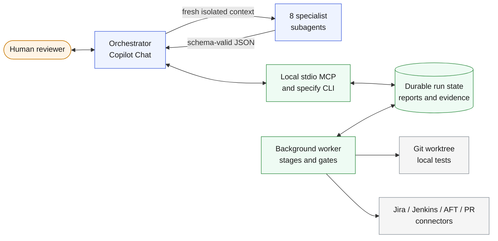
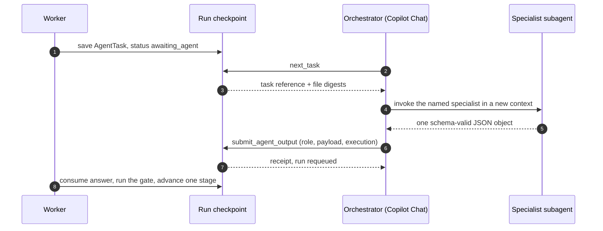

# Lockstep

**Evidence-gated vulnerability remediation from ACC to ACS.**

Lockstep takes a resolved ACC Jira vulnerability ticket, follows it to the real
upstream fix, decides whether ACS is affected, and carries the fix across under
human approval. Nothing advances without evidence: the vulnerability must fail
before the patch and pass after it, independent code and security reviewers must
clear the diff, Jenkins must build the exact commit, AFT must test that artifact,
and QA must account for every acceptance criterion before a review-ready PR is
created. Specialist AI agents propose; a deterministic worker verifies, gates and
records. The two move in lockstep, and a human sets the pace at the approval gate.

Lockstep is derived from [GitHub Spec Kit](https://github.com/github/spec-kit)
and keeps its MIT license, durable workflow engine and `specify` executable.



## Why it exists

Backporting a security fix between two product lines is slow because the same
questions repeat on every ticket: what did the upstream fix actually change, does
the downstream code share the flaw, which tests prove the hole is closed, and did
the build that shipped really contain the fix. Lockstep automates the gathering
and the bookkeeping while refusing to automate the judgment. An agent's prose can
never mark a test as passed, approve a plan or publish a PR.

## Quick start (offline demo)

Install Python 3.11+ and Git. From this checkout:

```bash
uv sync --extra test
```

```bash
.venv/bin/specify init --project-dir /absolute/path/to/lockstep-demo
```

```bash
.venv/bin/specify remediation doctor --project-dir /absolute/path/to/lockstep-demo
```

```bash
.venv/bin/specify remediation run ACC-101 --project-dir /absolute/path/to/lockstep-demo
```

On Windows use `.venv\Scripts\specify.exe`. Choose a new demo directory: `init`
creates ACC and ACS fixture repositories with a real path-traversal flaw, a local
bare ACS remote, configuration, the Copilot agent pack and VS Code MCP settings.
`doctor` is a read-only preflight that confirms the project is ready. Jira,
Jenkins, AFT and PR hosting are simulated; no credentials, network access or
Copilot subscription are needed.

The run pauses at `approval`. Read the generated `report.md`, then approve the
exact run ID and plan digest it shows:

```bash
.venv/bin/specify remediation status --project-dir /absolute/path/to/lockstep-demo
```

```bash
.venv/bin/specify remediation approve RUN_ID --plan-digest DIGEST --reviewer "Your name" --project-dir /absolute/path/to/lockstep-demo
```

```bash
.venv/bin/specify remediation report RUN_ID --project-dir /absolute/path/to/lockstep-demo
```

The worker continues through repair, verification, simulated Jenkins and AFT, final
QA and simulated PR creation. The PR record lands in
`.specify/remediation/mock-services.json`; its `.invalid` URL is a demo identifier,
not a hosted PR. Stop the worker when you are done:

```bash
.venv/bin/specify remediation worker stop --project-dir /absolute/path/to/lockstep-demo
```

Runtime state, fixture repositories and generated editor files are Git-ignored,
so a clone starts clean. The [workspace guide](docs/workspace.md) shows how a
completed run's evidence is laid out and inspected in a maintainer checkout.

## The pipeline

Every run moves through eleven stages. One worker tick advances one stage, and
each transition is checkpointed so a crash, restart or closed editor resumes
exactly where it stopped.

```mermaid
stateDiagram-v2
    direction LR
    classDef gate fill:#fff4e5,stroke:#c77700,color:#1a1a1a
    classDef ext fill:#f5f5f5,stroke:#868e96,color:#1a1a1a

    [*] --> intake
    intake --> analysis: fix diff verified<br/>ACS ticket linked
    analysis --> qa_plan: affected
    analysis --> done: not affected /<br/>already fixed
    qa_plan --> approval: coverage matrix complete
    approval --> repair: human approves digest
    repair --> verification: patch applied in worktree
    verification --> repair: tests or reviews fail<br/>(max 2 attempts)
    verification --> build: regression, checks,<br/>code + security review pass
    build --> aft: Jenkins success + artifact
    aft --> qa_review: AFT suites pass
    qa_review --> publish: every criterion covered
    publish --> done: PR created
    done --> [*]

    class approval gate
    class build, aft ext
```



Any failed or ambiguous condition pauses the run with a diagnostic instead of
guessing. Resume re-evaluates the same evidence and reuses the same external jobs;
it never re-approves a plan or submits a second expensive build.

| Stage | Who acts | What must be true to leave it |
| --- | --- | --- |
| intake | Worker, ACC investigator | Ticket resolved; fix commit, parent, diff and regression source match local Git objects; no investigator blockers |
| analysis | ACS analyst | Clean ACS checkout at target; applicability, allowed paths, exposure, adaptation and before/after impact supplied |
| qa-plan | QA engineer | Every analyst-required test mapped to configured local checks and AFT suites; vulnerability, normal and boundary coverage; no gaps |
| approval | Human | Reviewer records the exact current plan digest |
| repair | Remediation engineer | Regression reproduces the vulnerability first; proposal stays within approved paths |
| verification | Worker, code reviewer, security reviewer | Regression and all checks pass untruncated with passing-test patterns; both reviews approve with no blocking, high or critical findings |
| build | Jenkins | Exact pushed commit builds and yields an artifact |
| aft | AFT, build/AFT coordinator | Same commit and artifact; required suites all `passed`; no coordinator blockers |
| qa-review | QA engineer | Assessment binds plan, commit, tests, reviews and jobs; all criterion IDs covered |
| publish | PR publisher, worker | Approval, verification, AFT and QA still current; narrative has no blockers |

## How agents and the worker share the work

Specialists never touch the filesystem, run commands or call services. Each one
receives a self-contained prompt, the exact JSON schema it must return and the
evidence it may use. The worker validates the response strictly and applies it
only through its own gates. In `agent: vscode` mode this handoff is durable: the
worker parks a task in the run checkpoint, Copilot Chat dispatches the named
specialist in a fresh isolated context, and the typed response is queued back.



Task identity binds the run, stage, attempt, retry epoch, schema, profile digest
and a digest of the source trees. Any change to those invalidates the task. Lost
replies are acknowledged idempotently; conflicting duplicates are rejected; a
reused subagent context is refused. See [native execution](docs/native-copilot.md).

## Operating modes

| Setting | Meaning |
| --- | --- |
| `mode: mock` | Jira, Jenkins, AFT and PR are simulated in `.specify/remediation/mock-services.json`; Git operations are real |
| `mode: mcp` | Every service call goes through operator-configured MCP tools with idempotency keys. See [connector contracts](docs/connectors.md) |
| `agent: stub` | Deterministic offline specialists for the demo only; refused with live services |
| `agent: vscode` | Specialists run as isolated VS Code Copilot subagents through durable task handoffs (default for live projects) |
| `agent: copilot` | Specialists run through the authenticated Copilot CLI dispatcher |

Open an initialized directory in VS Code, enable the generated `.vscode/mcp.json`
server and select `remediation-orchestrator` in Copilot Chat. Chat and CLI share
one worker and one persisted state. For real systems initialize with `--no-demo`,
configure repository paths, regression and local-check commands, AFT requirements
and MCP bindings, then run `doctor` until it reports no errors.

## Harness guarantees

- **Evidence before edits.** No file is written until the vulnerability failure is
  reproduced and a human has approved the specific plan digest.
- **Agents propose, the worker disposes.** Structured output is validated against a
  closed schema; an agent's approval cannot override a failed check or a blocking
  finding.
- **Everything binds to a digest.** Plan approval, reviews, QA assessment and jobs
  reference the exact source tree and commit. Changing the tree invalidates them.
- **Side effects are reconciled, not repeated.** Intent is persisted before any
  external call; connectors must support lookup by idempotency key.
- **Pauses are explicit.** Every stop has a `required_action` and shows up in
  `status`, `doctor` and the report timeline.
- **Observable by default.** Reports include agent activity with profile digests,
  the QA matrix, structured findings, a collapsed event timeline and an unchecked
  human acceptance checklist. The worker publishes a heartbeat beside its lock.

The full gate catalog, failure handling and trust boundaries are in the
[harness guide](docs/harness.md).

## Commands

| Command | Purpose |
| --- | --- |
| `specify init` / `specify remediation init [--no-demo] [--agent vscode]` | Create or check a control project and install the agent pack |
| `specify remediation doctor` | Read-only preflight: configuration, repositories, commands, connectors, agent pack, worker, runs |
| `specify remediation run ACC-101 [ACC-102 ...]` | Queue one durable run per ticket and start the worker |
| `specify remediation status` | Stages, required actions and evidence for every run |
| `specify remediation approve RUN --plan-digest D --reviewer NAME [--reject]` | Record the human decision on the current plan |
| `specify remediation resume RUN` / `cancel RUN` | Continue a paused run after fixing its cause, or stop it while preserving evidence |
| `specify remediation report RUN` | Write and return the Markdown evidence report |
| `specify remediation next-task` / `submit-agent-output FILE` | Native task retrieval and typed submission (also available to drivers and tests) |
| `specify remediation worker start` / `status` / `stop` / `run` | Manage the shared background worker |
| `specify mcp --project-dir PATH` | Host the same operations as MCP tools over stdio |

All remediation commands print JSON on stdout and expected errors on stderr with
a nonzero exit code. Every command has an MCP twin named `specify_remediation_*`
except foreground `worker run`.

## Boundaries

Lockstep does not merge PRs, deploy, discover tickets on a schedule or run manual
QA. It executes one Jenkins build at a time, retains failed worktrees and logs for
inspection, deduplicates completed ticket/target requests and never resets an
exhausted repair budget. Copilot tool restrictions and path guards are defense in
depth, not an operating-system sandbox: run the worker under a scoped account for
production repositories. The default demo stays offline and labels simulated
results clearly.

## Documentation

- [Architecture](docs/architecture.md): components, state, evidence binding and recovery
- [Harness guide](docs/harness.md): gate catalog, failure handling, observability and trust boundaries
- [Operator guide](docs/operations.md): commands, troubleshooting, demo scenarios
- [Agent contracts](docs/agent-contracts.md): specialist inputs, outputs and enforced boundaries
- [Copilot-native execution](docs/native-copilot.md): durable task protocol and live smoke checklist
- [Connector contracts](docs/connectors.md): Jira, Jenkins, AFT and repository operations for live systems
- [Persistent demo and workspace](docs/workspace.md)
- [Roadmap](docs/roadmap.md): recommended next harness improvements
- [Migration from Spec Kit](docs/migration.md)
- [Contributing](CONTRIBUTING.md) and [Security](SECURITY.md)

Run the suite with `.venv/bin/python -m pytest` after `uv sync --extra test`.
Runtime, CLI, MCP stdio, recovery, file safety, preflight and the real local Git
demo have independent behavioral coverage. Live Copilot and service smoke tests
are opt-in.

Lockstep retains the MIT license and attribution of
[GitHub Spec Kit](https://github.com/github/spec-kit).
