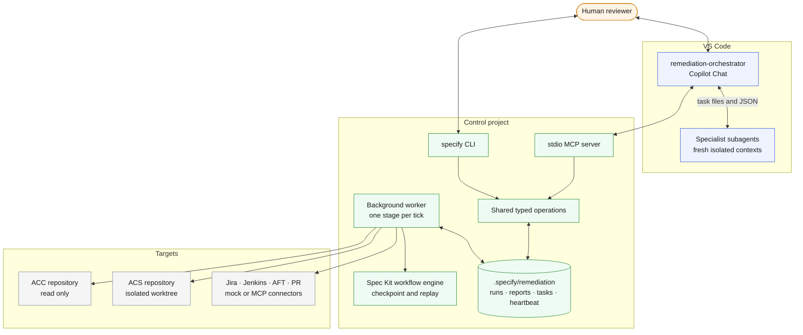
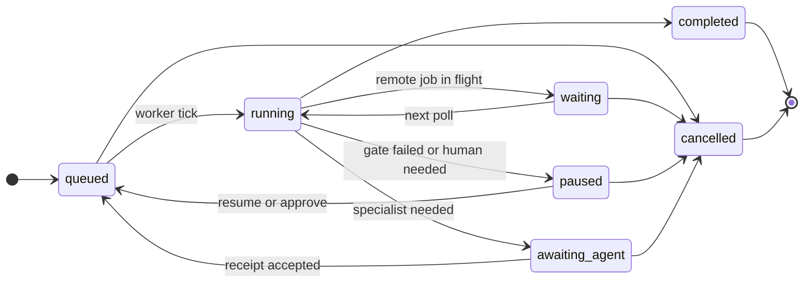
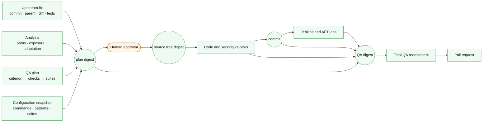

# Architecture

Lockstep has three kinds of participants. Humans decide, through Copilot Chat or
the CLI. Specialist agents reason over supplied evidence and return typed JSON. A
single local background worker executes deterministic stages, applies every
change, runs every command and records every result. The CLI and MCP adapters are
thin peers over shared typed operations under `src/specify_cli/remediation`.

An interactive version of this page, with the pipeline, lifecycle and handoff
animated, is [walkthrough.html](walkthrough.html); open it in a browser.

Default `init` creates an offline demo with the deterministic stub. `agent: vscode`
routes specialist reasoning through durable task handoffs to isolated VS Code
subagents; `agent: copilot` retains the authenticated CLI dispatcher.

## Execution and state

One registered remediation step advances one domain stage per worker tick. The
retained workflow engine owns occurrence checkpoint and replay. Domain state lives
in `.specify/remediation/runs/RUN_ID/state.json`; engine checkpoints live in
`.specify/workflows/runs/RUN_ID/`. Reports, native task files and the repair
worktree sit beside the domain state. Configuration is snapshotted when a run is
queued, so later edits affect only new runs.

Run status is separate from stage. A run at stage `approval` is `paused` until a
human records a decision; a run at stage `build` is `waiting` while Jenkins runs.
The worker skips `awaiting_agent` runs until an accepted receipt requeues them.

## Evidence binding

Nothing is trusted because an agent said it. Each decision is bound to a digest of
the exact inputs it was made from, and later stages recheck those digests.

Intake follows the ticket-linked ACC repository through `repository.fix` and
matches the returned commit, parent, diff and regression sources against local
Git objects. The plan digest binds that evidence with the analysis, the QA matrix
and the configured commands. Reviews bind the source-content digest of the
worktree they inspected. Final QA binds plan, commit, local evidence, reviews and
job identities. Any change to a bound input invalidates everything downstream and
returns the run to approval with a fresh digest.

Reports and PR bodies contain the upstream and ACS diffs, predicted versus
observed behavior, unknowns, the collapsed event timeline and separate human
checklists for plan approval and final acceptance. Checklist items are never
marked as reviewed by the toolkit.

## Specialists

Eight profiles serve nine reasoning checkpoints: ACC investigator, ACS analyst,
QA engineer (planning and final assessment), remediation engineer, code reviewer
(`verification-reviewer`), security reviewer, build/AFT coordinator and PR
publisher. Each dispatch embeds the canonical profile, run context, exact JSON
schema and evidence. Activity records carry the profile digest. Investigator,
coordinator and publisher notes can return explicit blockers; the worker persists
them and pauses before the next side effect. See [agent contracts](agent-contracts.md).

Specialists have read and search tools only. Code changes are proposed as complete
file contents and applied by the worker inside approved paths. Backend exit codes,
passing-test patterns and service results establish verification; agent prose does
not. Copilot profiles and CLI permission flags are defense in depth, not an
operating-system sandbox.

## Approval and recovery

Approval binds the reviewer, plan digest, source revisions and configured tests.
Out-of-scope proposals pause before any edit. A changed worktree after
verification invalidates evidence and approval. MCP hosts must present approval as
a human decision; a tool-call confirmation cannot substitute for it.

State writes use temporary files and atomic replacement. Kernel file locks
serialize domain mutation, worker launch and worker lifetime, and process death
releases them. The worker records a heartbeat beside its lock so `worker status`
and `doctor` can distinguish a live worker from a hung one. A restart resumes the
recorded stage and already-submitted job.

Mutations record intent before contacting a service. Connectors provide lookup by
idempotency key and enforce that key when submitting; an ambiguous lookup is an
error. External jobs use short polling calls with a default two-hour timeout.
Failed jobs pause; resume inspects the same job and never submits another
expensive build. Cancel stops local progress, preserves remote jobs and worktrees
and prevents PR publication.

## Native Copilot handoffs

`agent: vscode` pauses at `awaiting_agent` with an atomic task record in the domain
checkpoint. Retrieval and submission are shared typed operations; submission
validates and requeues, and only the worker advances the workflow engine. Receipts
survive lost replies and reject conflicting duplicates. Task identity binds
profile, schema, context and source evidence; stale submissions cannot repair or
publish. Context isolation is provided by VS Code and declared by the host, not
authenticated by MCP. See [native execution](native-copilot.md).

## Product boundary

Retained Spec Kit components include the execution tree, expressions, local
workflow composition, file policy and helper primitives, manifest ownership and
archive and network security helpers. Generic feature workflows, package catalogs,
other assistant integrations and publishing automation have been removed. There
is no hosted scheduler, merge or production deployment service. The
[harness guide](harness.md) catalogs every gate; the [roadmap](roadmap.md) lists
recommended next steps.
