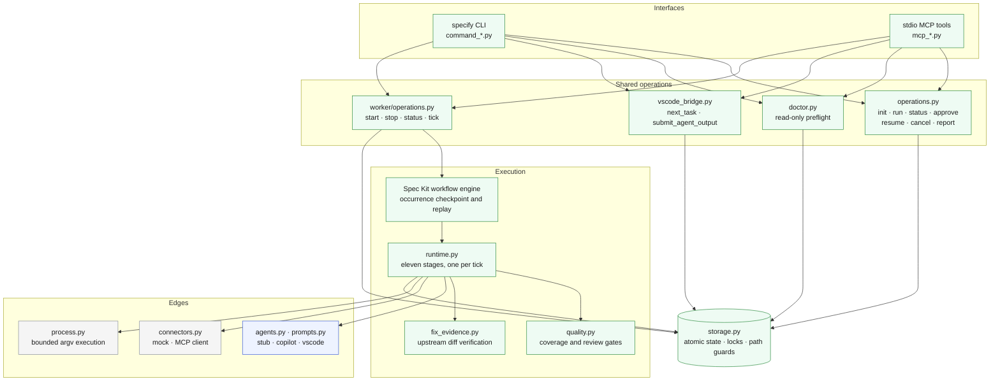
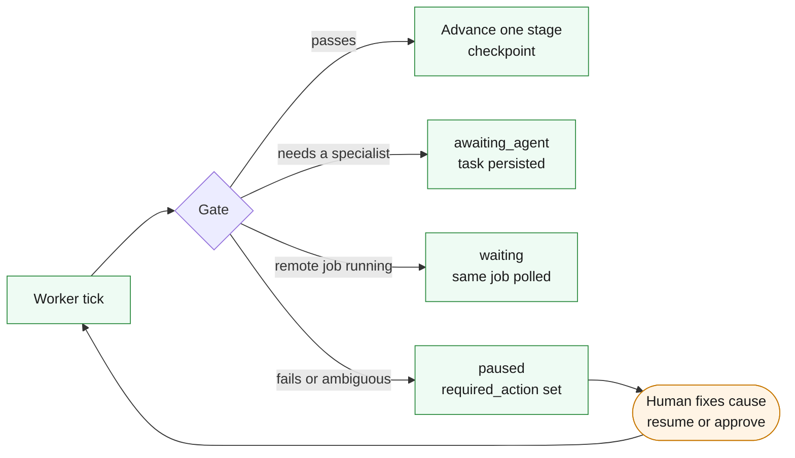
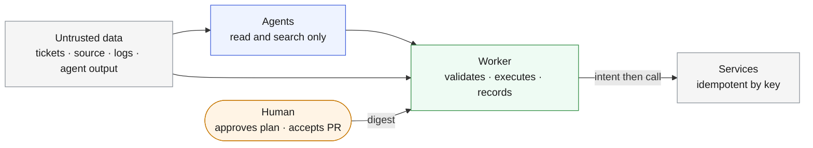

# Harness guide

The harness is everything around the model: the worker that advances stages, the
gates that decide whether evidence is sufficient, the checkpoint that makes every
step durable, the adapters that expose it to humans and hosts, and the diagnostics
that make its state legible. This guide catalogs those parts so a change to one
can be checked against the others.

## Layers

CLI and MCP are peers over the same typed operations and never call each other.
Semantic validation, approval, state changes and side effects live below both.
See [shared operations](../design/shared.md).

## Gate catalog

Each gate is enforced in code by the worker, independent of what any agent says.
The table names the enforcing function so reviewers can find the test that covers
it under `tests/specify_cli/remediation/`.

| Gate | Stage | Enforced by | Pauses when |
| --- | --- | --- | --- |
| Resolved ticket with fix evidence | intake | `runtime.advance` | Ticket is not resolved, or lacks fix commit, source paths or regression test |
| Upstream fix verified against Git | intake | `fix_evidence.verify`, `validate_reference` | Commit, parent, diff, changed paths or regression contents differ from local objects; merge or multi-commit fixes |
| Investigator blockers | intake | `require_clear_note` | The evidence note lists blockers |
| Clean ACS checkout | analysis | `runtime.advance` | HEAD is not the captured target revision or the tree is dirty |
| Applicability decided | analysis | `runtime.advance` | Analyst returns `inconclusive` |
| Adaptation and impact present | analysis, approval | `agent_output.parse_output`, `operations.approve` | Analysis lacks adaptation notes or before/after impact |
| QA coverage complete | qa-plan, approval, every later stage | `quality.validate_plan` | Gaps, duplicate IDs, unmapped analyst requirement, unconfigured check or suite, missing kind |
| Human approval of exact digest | approval, repair, build, aft, qa-review, publish | `plan_hash`, `require_approved_quality` | Digest missing or stale |
| Regression reproduces first | repair | `runtime.advance` | Regression passes, output is truncated or lacks the expected failure signature |
| Patch within approved scope | repair, verification | `validate_source_path`, path set comparison | Proposal touches control paths or paths outside `allowed_paths` |
| Repair budget | repair, verification | `run.attempts` | Third attempt would be needed |
| Local checks prove each case | verification | `quality.validate_checks` | Any command fails, is truncated or its passing-test pattern is absent |
| Independent code and security review | verification, build, aft, qa-review, publish | `quality.review_passes`, `validate_reviews` | Not approved, digest mismatch, or any blocking, high or critical finding |
| Source unchanged during verification | verification | `working_digest` comparisons | Tree digest changes while tests, reviews or the commit run |
| Commit identity | build, aft | `check_job`, `unchanged` | Job reports another commit, worktree HEAD moved or became dirty |
| Build artifact | build | `runtime.advance` | Success without an artifact |
| Job timeout and failure | build, aft | `check_job` | Failed status or elapsed time beyond `build_timeout`; the job is retained |
| AFT evidence matches | aft, qa-review, publish | `validate_aft` | Commit, artifact, environment or a required suite does not match `passed` |
| Coordinator and publisher blockers | aft, publish | `require_clear_note` | Their evidence notes list blockers |
| Final QA assessment | qa-review, publish | `quality.validate_acceptance` | Not approved, digest mismatch or criterion IDs not fully covered |
| External effect reconciliation | any side effect | `runtime.effect` | Idempotency lookup is ambiguous |
| Native task freshness | any native handoff | `vscode_bridge.validate_current` | Stage, attempt, epoch, schema, profile, prompt, source digests or task files changed |

## Failure handling

- **Paused** runs name the condition in `required_action`. Resume re-runs the same
  stage against the same evidence. It cannot approve a plan, reset the repair
  budget or erase a job ID. Code and security review rejections return to repair
  automatically within the two-attempt budget.
- **Waiting** runs poll one Jenkins or AFT job with short calls. There is one
  build slot: a run that reaches `build` while another run's job is queued or
  running is held there, without a pause, until that job terminates. Every other
  run keeps advancing through its local stages. A cancelled run keeps occupying
  the slot until its job terminates remotely. `status --summary` shows which run
  holds the slot a held run is waiting for.
- **Awaiting agent** runs hold an atomic task record. Only an accepted receipt
  requeues them; only the worker consumes the answer. Other runs are not blocked
  behind them.
- **Scheduling** is least-recently-touched first among eligible runs, so a run
  polling a long job and a run doing local work alternate instead of one
  starving the other.
- **Cancelled** runs stop local progress, keep the worktree and remote jobs for
  inspection, and refuse new submissions.
- **Changed trees** after approval or verification revoke approval, reviews, QA
  and job evidence together and return the run to `approval` with a fresh digest.

## Durability

Domain state lives in `.specify/remediation/runs/RUN_ID/state.json`; engine
checkpoints live in `.specify/workflows/runs/RUN_ID/`. Every write is a temp file
plus atomic replace with `fsync`. Kernel file locks (`state.lock`, `worker.lock`,
`launcher.lock`) serialize mutation, worker lifetime and worker launch; process
death releases them. Intent is recorded before each external effect so a crash
between the remote call and the local checkpoint is reconciled by key, never
replayed blindly.

The event log inside `state.json` folds a repeat of the previous event into a
`count` and `last` timestamp instead of appending it, so a run that polls a
two-hour job does not grow by one row per poll. The report is re-rendered only
when something a reader can see has changed: stage, status, required action or a
job status. Polling an unchanged job rewrites nothing.

## Observability

| Signal | Where | What it tells you |
| --- | --- | --- |
| `specify remediation doctor` | CLI, MCP `specify_remediation_doctor` | Read-only preflight: configuration, agent mode, repositories and target branch, regex and command resolution, connector bindings and secrets, agent pack integrity, worker liveness, runs needing attention. Errors would block a live run; warnings need review |
| `specify remediation status` | CLI, MCP | Every run's stage, status, `required_action`, evidence and external identities |
| `specify remediation status --summary` | CLI; MCP `{"summary": true}` | One row per run (run, ticket, stage, status, age since last change, required action or the run holding the build slot) as a text table in `message` and typed rows in `details.summary` |
| Worker heartbeat | `worker status` → `details.heartbeat`; file `.specify/remediation/worker.heartbeat.json` | PID, start time, tick count, whether the last tick advanced a run, the run, stage and status most recently advanced (`last_advanced`, kept through idle polls), age in seconds. The kernel lock proves a process exists; the heartbeat shows it is still ticking |
| Structured worker log | `.specify/remediation/worker.events.jsonl` | One JSON object per line: `worker_started`, a `tick` per advanced run with run, stage, status and elapsed seconds, `idle` at the start of each idle streak, `worker_stopped`. Rotated once to `.jsonl.1` past 5 MB |
| Report timeline | `report.md` → "Timeline" | Ordered worker events with details; repeated identical checkpoints while waiting are collapsed with a repeat count |
| Agent activity | `report.md` → "Orchestrator agent activity" | Each specialist invocation with stage, status, profile digest and, for native tasks, host-declared execution provenance |
| Structured findings | `report.md`, `state.json` | Reviewer findings with severity, location, evidence, correction and blocking flag, including historical attempts |
| Worker log | `.specify/remediation/worker.log` | Process stdout and stderr of the detached worker |
| Native task files | `native-tasks/TASK_ID/{prompt.txt,schema.json,evidence.yml}` | Exactly what a specialist was asked, verified by digest on submission |

The doctor never writes, never takes the state lock for mutation and never
contacts a service. Its `agent-pack` check reads the ownership manifest so edited
profiles are reported as preserved customizations rather than errors.

## Trust boundaries

- Repository, ticket and log content is data, never instruction. Prompts say so
  explicitly and every agent response is parsed with a closed schema.
- Agent profiles restrict tools to read and search. These restrictions, Copilot
  CLI permission flags and path guards are defense in depth, not an operating
  system sandbox. Run the worker under a scoped account or container for real
  repositories.
- Native invocation provenance (`execution`) is declared by the host. The backend
  cannot authenticate that a model ran in a separate context; it enforces the
  gates that do not depend on that claim and refuses reused context identifiers.
- Secrets reach connectors only through named environment variables. They never
  enter configuration, prompts, reports or results.
- Configured tests, regression and local checks run with an allowlisted
  environment (`command_env_names`, defaulting to interpreter, locale, path and
  proxy variables). The Copilot CLI additionally receives `agent_env_names`. Any
  variable a connector names as a secret is removed from both sets at use, and
  configuration that lists one is rejected. Code an agent proposed therefore
  cannot read connector credentials from the worker's environment.
- MCP tool annotations describe side effects conservatively so hosts can ask for
  confirmation, but hosts do not grant human approval. Approval is a recorded
  decision on a specific digest.

## Extending the harness safely

1. Put behavior in a shared operation or focused module, never in an adapter.
2. Give every new operation a CLI module and an MCP module with mirrored tests,
   and add it to the inventory so the parity test sees it.
3. Make new checkpoint fields optional so old runs stay readable.
4. Prefer pausing with a diagnostic over guessing; never fall back to fabricated
   output when a model or service misbehaves.
5. Add a positive and a negative test, and for a fix a before/after regression.
   See [CONTRIBUTING](../CONTRIBUTING.md).
